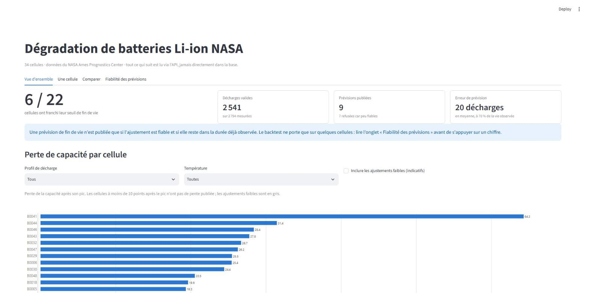
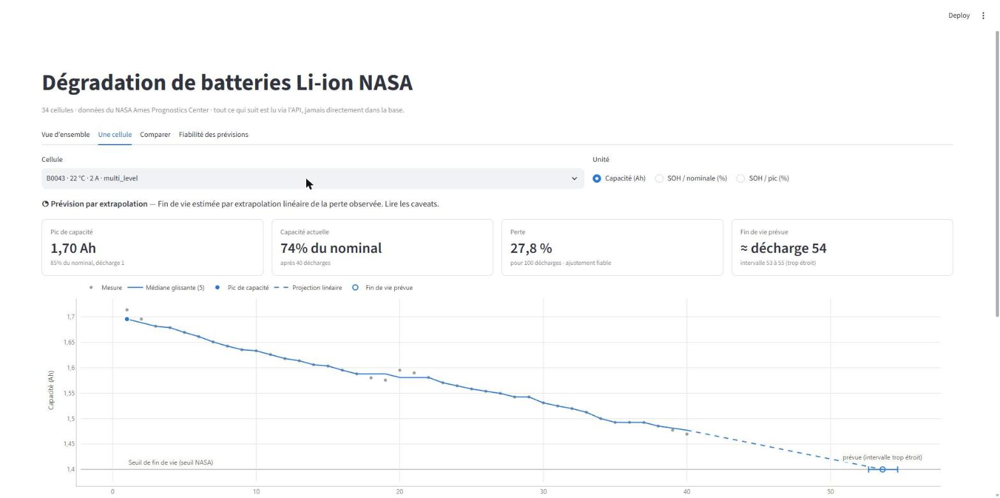
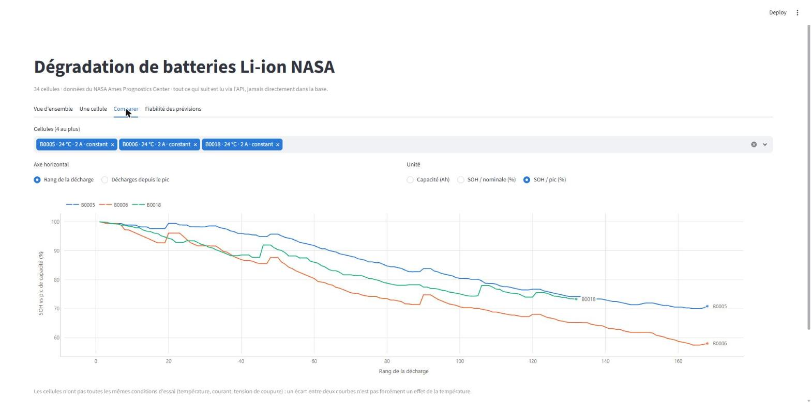
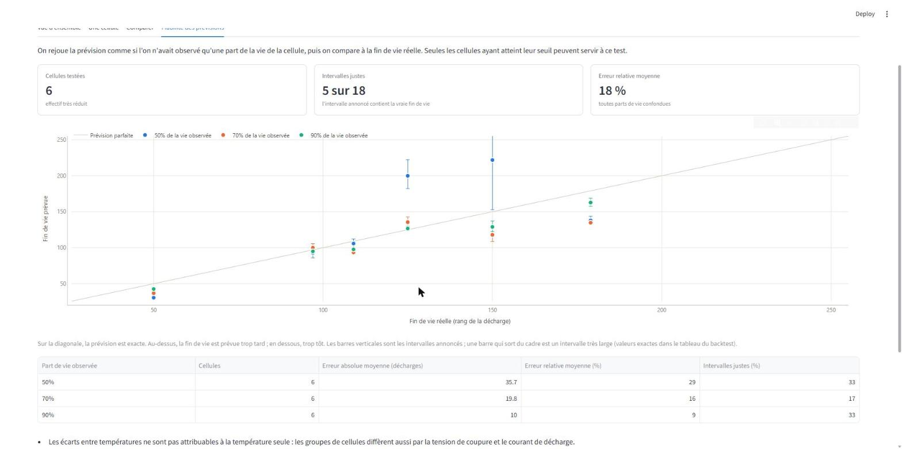
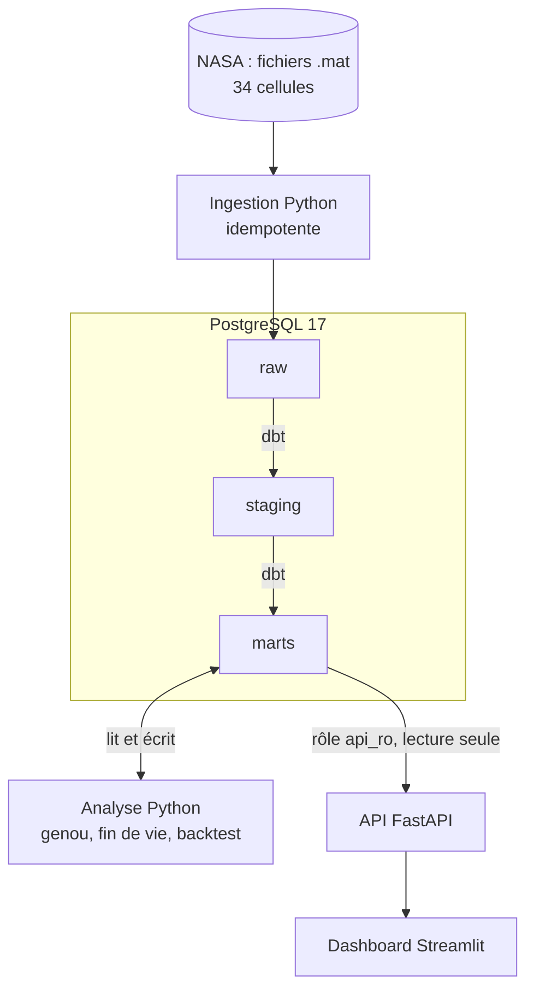

# EV Battery Analytics

[](https://github.com/keysha18/ev-battery-analytics/actions/workflows/ci.yml)


Pipeline de data engineering de bout en bout sur la **dégradation de batteries Li-ion** : ingestion de fichiers
MATLAB bruts, PostgreSQL, transformations dbt, analyse de fin de vie, API FastAPI et dashboard Streamlit.
Les données sont les 34 cellules du [NASA Ames Prognostics Center](https://www.nasa.gov/intelligent-systems-division/discovery-and-systems-health/pcoe/pcoe-data-set-repository/)
(entrée « Battery Data Set »).



Ce n'est **pas** un modèle prédictif prêt pour la production : c'est un projet qui montre comment construire une
chaîne de données fiable, et comment dire honnêtement ce que les données permettent de conclure (voir
[Limites](#limites-à-connaître)).

## Ce que le projet met en pratique

- **Ingestion idempotente** de fichiers `.mat` (NASA), avec empreinte sha256, version du loader, journal des
  chargements et gestion des doublons : relancer ne duplique rien.
- **Architecture en couches** `raw` → `staging` → `marts` dans PostgreSQL, transformations et tests en **dbt**.
- **Qualité des données** : les valeurs douteuses sont *marquées*, pas supprimées ; 62 tests dbt dont des
  réconciliations de lignes entre couches.
- **Analyse de dégradation** : état de santé (SOH), pente de perte, détection du « genou », prévision de fin de
  vie validée par un **backtest**.
- **API en lecture seule** (rôle PostgreSQL dédié) et **dashboard** qui ne lit que l'API.
- **Industrialisation** : Docker, CI GitHub Actions qui reconstruit tout de zéro, pre-commit, 93 tests.

## Aperçu

| Une cellule : prévision et réserves | Comparer des cellules |
|---|---|
|  |  |



## Architecture



| Couche | Rôle |
|---|---|
| `raw` | Résumé par cycle de chaque cellule (7 565 cycles) et séries complètes pour 4 cellules de démonstration. Aucune valeur corrigée. |
| `staging` | Typage, conditions d'essai (seed transcrit des README NASA), validité des capacités. |
| `marts` | Modèle analytique : `dim_battery`, `fact_discharge`, `fact_impedance`, `fact_degradation`, résumé par cellule, et les tables écrites par l'analyse Python. |

**Stack** : Python 3.12 (uv), PostgreSQL 17, dbt-core 1.12, FastAPI, Streamlit + Plotly, Docker Compose,
GitHub Actions.

## Démarrage

Prérequis : Docker (Compose v2), `make`, [uv](https://docs.astral.sh/uv/).
Sous Windows : WSL2 avec Docker Desktop, et cloner le dépôt **dans le système de fichiers Linux** (pas sous `/mnt/c`).

```bash
cp .env.example .env     # valeurs de développement : à changer avant tout usage hors local
make up                  # PostgreSQL
make download            # ~200 Mo, sha256 vérifié
make ingest              # .mat -> raw (relançable sans doublons)
make dbt-build           # seed, staging, marts et leurs tests
make analyze             # genou, fin de vie, backtest
make dashboard           # API sur :8000/docs, dashboard sur :8501
```

`make help` liste toutes les commandes. Qualité : `make lint`, `make test` (PostgreSQL et marts requis),
`make hooks` (pre-commit). La CI exécute exactement cette séquence sur un runner vierge.

## Résultats

Sur 2 794 décharges mesurées, 2 541 sont valides. 22 cellules ont un critère de fin de vie défini.

- **6 cellules sur 22** ont franchi leur seuil de fin de vie (B0005 à la décharge 125, B0006 à 109, B0018 à 97, B0033,
  B0034, B0045).
- Une prévision n'est publiée que pour **9 cellules** ; elle est **refusée pour 7** (ajustement peu fiable, ou fin
  de vie bien au-delà de ce qui est observé).
- Un **genou** (perte qui s'accélère) n'est détecté que dans **2 cellules sur 22**.
- **Backtest** (6 cellules) : l'erreur moyenne de la fin de vie prévue est de 36, 20 puis 10 décharges quand on a
  observé 50, 70 puis 90 % de la vie.

Méthode détaillée : [`docs/degradation.md`](docs/degradation.md). Données et anomalies : [`docs/dataset.md`](docs/dataset.md).

## Choix de conception

- **Ne rien supprimer, tout marquer.** Capacités vides, nulles ou aberrantes sont gardées avec `is_valid_capacity` et
  `invalid_reason` ; les seuils sont des variables dbt. L'audit reste possible et les règles sont visibles.
- **Condition principale par cellule.** La capacité dépend de la température et du courant : sans filtrer, un
  changement de régime ressemblerait à du vieillissement (cas de B0042-44).
- **Référence = pic de capacité**, pas la première mesure, car plusieurs cellules montent d'abord (conditionnement).
- **Fin de vie** : seuil absolu NASA quand la cellule démarre nettement au-dessus, sinon seuil relatif à son pic.
  À 4 °C, plusieurs cellules sont sous le seuil NASA dès la première décharge, à cause de la température.
- **Refuser plutôt que mal prédire.** Pas de chiffre si l'ajustement est faible ou si l'horizon dépasse la durée
  observée. Chaque réponse de l'API porte ses `caveats`, dont les chiffres du backtest calculés en direct.
- **Moindre privilège.** L'API se connecte avec un rôle en lecture seule sur `marts` (et `default_transaction_read_only`
  en second verrou) ; le dashboard n'a aucun identifiant de base et ne parle qu'à l'API.
- **La CI est la source de vérité.** Elle rejoue l'ingestion une seconde fois pour vérifier l'idempotence.

## Limites à connaître

- **Heuristiques sans vérité terrain** : seuil de validité (25 % du nominal), marge de 1,15 sur le seuil NASA, seuils
  de fiabilité et du genou. Aucun n'est calibré ; ils sont listés dans `docs/degradation.md`.
- **Backtest sur 6 cellules seulement** : ce sont des ordres de grandeur. Les intervalles annoncés sont **trop
  étroits** (ils contiennent la vraie fin de vie dans 5 cas sur 18) car ils ne reflètent que l'incertitude sur la pente.
- **Effets confondus** : les groupes de cellules diffèrent par la température, le courant et la tension de coupure ;
  on ne peut pas attribuer un écart de dégradation à la température seule.
- **Cellules froides (4 °C)** : comportement mal compris, NASA le signale elle-même dans ses README.
- **Hors périmètre** : pas d'authentification ni de limitation de débit sur l'API (usage local), pas de texture
  d'accessibilité dans les graphiques, et changer de thème Streamlit en direct ne redessine pas les graphiques
  avant un rechargement. L'image du dashboard est lourde (~1,5 Go).

## Structure

```
src/ingest/      lecture des .mat, chargement idempotent dans raw
src/analytics/   genou (régression à cassure), prévision de fin de vie, backtest
src/api/         FastAPI : routes, schémas, accès base en lecture seule
dashboard/       Streamlit : app, graphiques (fonctions pures), client HTTP
dbt/             modèles staging et marts, seed des conditions d'essai, tests
sql/             init des schémas et rôles, DDL raw et tables d'analyse
tests/           unitaires et intégration (base réelle) ; docs/  méthode et données
.github/         CI, Dependabot
```

## Données et licence

Le code est sous licence [MIT](LICENSE). Les données NASA ne sont **pas** redistribuées : `make download` les récupère
depuis la source et vérifie leur empreinte. La page NASA ne précise pas de licence ; citer la source (NASA Ames
Prognostics Center of Excellence) pour tout usage.
